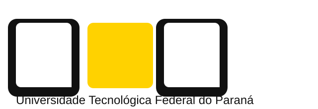
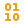

# **Pós-Graduação em Desenvolvimento Web com TypeScript e Inteligência Artificial**

### Universidade Tecnológica Federal do Paraná (UTFPR)

   <strong>Aluno:</strong> Bruno E. M. Ferreira &nbsp;|&nbsp;
   <strong>Turma:</strong> 2026 &nbsp;|&nbsp;
   <strong>Período:</strong> Abril/2026 &ndash; Março/2028

 

###  Tecnologias do Curso

---

##  Navegação Rápida

- [Sobre Este Repositório](#sobre-este-repositorio)
- [Cronograma e Disciplinas](#cronograma-e-disciplinas)
- [Links Úteis](#links-uteis)
- [Observações](#observacoes)

---

##  Sobre Este Repositório

Este repositório atua como um portfólio central e diário de bordo para a **Pós-Graduação em Desenvolvimento Web com TypeScript e Inteligência Artificial** da UTFPR.

Aqui você encontrará:

-  O **cronograma completo de disciplinas**.
-  **Projetos desenvolvidos** ao longo do curso.
-  **Atividades práticas**, laboratórios e anotações de estudo.

---

##  Cronograma e Disciplinas

Abaixo estão listadas todas as disciplinas do curso organizadas em formato de cards interativos. Cada card apresenta as tecnologias, período de realização, corpo docente e duas divisões dedicadas para os **exercícios** e o **projeto final**.

 

<!-- ==================== CARD 1 ==================== -->
<table width="100%">
  <thead>
    <tr>
      <th colspan="2" align="left">
        
        
        
        &nbsp;<b>1. Desenvolvimento de Interfaces Web com HTML5 e CSS3</b>
      </th>
    </tr>
  </thead>
  <tbody>
    <tr>
      <td colspan="2">
        
        

          
          &nbsp;<b>Período:</b> 06/04/2026 até 24/05/2026  
          
          &nbsp;<b>Professores:</b> Prof. Dr. Andres Porfirio &bull; Prof. Dr. Diego Marczal
        

      </td>
    </tr>
    <tr>
      <th width="50%" align="center">
        
        &nbsp;Exercícios e Atividades
      </th>
      <th width="50%" align="center">
        
        &nbsp;Projeto Final
      </th>
    </tr>
    <tr>
      <td align="center">
        <a href="./01-desenvolvimento-de-interfaces-web-com-html5-e-css3/exercicios">
          
          &nbsp;Acessar Exercícios
        </a>
      </td>
      <td align="center">
        <a href="./01-desenvolvimento-de-interfaces-web-com-html5-e-css3/projeto-final">
          
          &nbsp;Acessar Projeto Final
        </a>
      </td>
    </tr>
  </tbody>
</table>

 

<!-- ==================== CARD 2 ==================== -->
<table width="100%">
  <thead>
    <tr>
      <th colspan="2" align="left">
        
        
        &nbsp;<b>2. Lógica de Programação para Desenvolvedores Web</b>
      </th>
    </tr>
  </thead>
  <tbody>
    <tr>
      <td colspan="2">
        
        

          
          &nbsp;<b>Período:</b> 01/06/2026 até 26/07/2026  
          
          &nbsp;<b>Professores:</b> <i>A definir</i>
        

      </td>
    </tr>
    <tr>
      <th width="50%" align="center">
        
        &nbsp;Exercícios e Atividades
      </th>
      <th width="50%" align="center">
        
        &nbsp;Projeto Final
      </th>
    </tr>
    <tr>
      <td align="center">
        <a href="./02-logica-de-programacao-para-desenvolvedores-web/exercicios">
          
          &nbsp;Acessar Exercícios
        </a>
      </td>
      <td align="center">
        <a href="./02-logica-de-programacao-para-desenvolvedores-web/projeto-final">
          
          &nbsp;Acessar Projeto Final
        </a>
      </td>
    </tr>
  </tbody>
</table>

 

<!-- ==================== CARD 3 ==================== -->
<table width="100%">
  <thead>
    <tr>
      <th colspan="2" align="left">
        
        
        
        &nbsp;<b>3. Desenvolvimento de Aplicações Web Dinâmicas e Interativas</b>
      </th>
    </tr>
  </thead>
  <tbody>
    <tr>
      <td colspan="2">
        
        

          
          &nbsp;<b>Período:</b> 24/08/2026 até 11/10/2026  
          
          &nbsp;<b>Professores:</b> <i>A definir</i>
        

      </td>
    </tr>
    <tr>
      <th width="50%" align="center">
        
        &nbsp;Exercícios e Atividades
      </th>
      <th width="50%" align="center">
        
        &nbsp;Projeto Final
      </th>
    </tr>
    <tr>
      <td align="center">
        <a href="./03-desenvolvimento-de-aplicacoes-web-dinamicas-e-interativas/exercicios">
          
          &nbsp;Acessar Exercícios
        </a>
      </td>
      <td align="center">
        <a href="https://github.com/brunoemferreira/utfpr-aplicacao-web-dinamica-e-interativa">
          
          &nbsp;Aplicação WEB Dinâmica e Interativa
        </a>
      </td>
    </tr>
  </tbody>
</table>

 

<!-- ==================== CARD 4 ==================== -->
<table width="100%">
  <thead>
    <tr>
      <th colspan="2" align="left">
        
        
        &nbsp;<b>4. Linux para Desenvolvedores e DevOps</b>
      </th>
    </tr>
  </thead>
  <tbody>
    <tr>
      <td colspan="2">
        
        

          
          &nbsp;<b>Período:</b> 19/10/2026 até 06/12/2026  
          
          &nbsp;<b>Professores:</b> <i>A definir</i>
        

      </td>
    </tr>
    <tr>
      <th width="50%" align="center">
        
        &nbsp;Exercícios e Atividades
      </th>
      <th width="50%" align="center">
        
        &nbsp;Projeto Final
      </th>
    </tr>
    <tr>
      <td align="center">
        <a href="./04-linux-para-desenvolvedores-e-devops/exercicios">
          
          &nbsp;Acessar Exercícios
        </a>
      </td>
      <td align="center">
        <a href="./04-linux-para-desenvolvedores-e-devops/projeto-final">
          
          &nbsp;Acessar Projeto Final
        </a>
      </td>
    </tr>
  </tbody>
</table>

 

<!-- ==================== CARD 5 ==================== -->
<table width="100%">
  <thead>
    <tr>
      <th colspan="2" align="left">
        
        
        
        &nbsp;<b>5. Controle de Versão e Colaboração com Git e GitHub</b>
      </th>
    </tr>
  </thead>
  <tbody>
    <tr>
      <td colspan="2">
        
        

          
          &nbsp;<b>Período:</b> 01/02/2027 até 14/03/2027  
          
          &nbsp;<b>Professores:</b> <i>A definir</i>
        

      </td>
    </tr>
    <tr>
      <th width="50%" align="center">
        
        &nbsp;Exercícios e Atividades
      </th>
      <th width="50%" align="center">
        
        &nbsp;Projeto Final
      </th>
    </tr>
    <tr>
      <td align="center">
        
      </td>
      <td align="center">
        
      </td>
    </tr>
  </tbody>
</table>

 

<!-- ==================== CARD 6 ==================== -->
<table width="100%">
  <thead>
    <tr>
      <th colspan="2" align="left">
        
        
        &nbsp;<b>6. Banco de Dados para Sistemas Web</b>
      </th>
    </tr>
  </thead>
  <tbody>
    <tr>
      <td colspan="2">
        
        

          
          &nbsp;<b>Período:</b> 22/03/2027 até 02/05/2027  
          
          &nbsp;<b>Professores:</b> <i>A definir</i>
        

      </td>
    </tr>
    <tr>
      <th width="50%" align="center">
        
        &nbsp;Exercícios e Atividades
      </th>
      <th width="50%" align="center">
        
        &nbsp;Projeto Final
      </th>
    </tr>
    <tr>
      <td align="center">
        <a href="./06-banco-de-dados-para-sistemas-web/exercicios">
          
          &nbsp;Acessar Exercícios
        </a>
      </td>
      <td align="center">
        <a href="./06-banco-de-dados-para-sistemas-web/projeto-final">
          
          &nbsp;Acessar Projeto Final
        </a>
      </td>
    </tr>
  </tbody>
</table>

 

<!-- ==================== CARD 7 ==================== -->
<table width="100%">
  <thead>
    <tr>
      <th colspan="2" align="left">
        
        
        &nbsp;<b>7. Programação Orientada a Objetos</b>
      </th>
    </tr>
  </thead>
  <tbody>
    <tr>
      <td colspan="2">
        
        

          
          &nbsp;<b>Período:</b> 10/05/2027 até 20/06/2027  
          
          &nbsp;<b>Professores:</b> <i>A definir</i>
        

      </td>
    </tr>
    <tr>
      <th width="50%" align="center">
        
        &nbsp;Exercícios e Atividades
      </th>
      <th width="50%" align="center">
        
        &nbsp;Projeto Final
      </th>
    </tr>
    <tr>
      <td align="center">
        <a href="./07-programacao-orientada-a-objetos/exercicios">
          
          &nbsp;Acessar Exercícios
        </a>
      </td>
      <td align="center">
        <a href="./07-programacao-orientada-a-objetos/projeto-final">
          
          &nbsp;Acessar Projeto Final
        </a>
      </td>
    </tr>
  </tbody>
</table>

 

<!-- ==================== CARD 8 ==================== -->
<table width="100%">
  <thead>
    <tr>
      <th colspan="2" align="left">
        
        
        
        &nbsp;<b>8. Desenvolvimento de Aplicações Back-End com NestJS</b>
      </th>
    </tr>
  </thead>
  <tbody>
    <tr>
      <td colspan="2">
        
        

          
          &nbsp;<b>Período:</b> 12/07/2027 até 22/08/2027  
          
          &nbsp;<b>Professores:</b> <i>A definir</i>
        

      </td>
    </tr>
    <tr>
      <th width="50%" align="center">
        
        &nbsp;Exercícios e Atividades
      </th>
      <th width="50%" align="center">
        
        &nbsp;Projeto Final
      </th>
    </tr>
    <tr>
      <td align="center">
        <a href="./08-desenvolvimento-de-aplicacoes-back-end-com-nestjs/exercicios">
          
          &nbsp;Acessar Exercícios
        </a>
      </td>
      <td align="center">
        <a href="./08-desenvolvimento-de-aplicacoes-back-end-com-nestjs/projeto-final">
          
          &nbsp;Acessar Projeto Final
        </a>
      </td>
    </tr>
  </tbody>
</table>

 

<!-- ==================== CARD 9 ==================== -->
<table width="100%">
  <thead>
    <tr>
      <th colspan="2" align="left">
        
        
        &nbsp;<b>9. Gestão de Projetos Web com Metodologias Ágeis</b>
      </th>
    </tr>
  </thead>
  <tbody>
    <tr>
      <td colspan="2">
        
        

          
          &nbsp;<b>Período:</b> 30/08/2027 até 10/10/2027  
          
          &nbsp;<b>Professores:</b> <i>A definir</i>
        

      </td>
    </tr>
    <tr>
      <th width="50%" align="center">
        
        &nbsp;Exercícios e Atividades
      </th>
      <th width="50%" align="center">
        
        &nbsp;Projeto Final
      </th>
    </tr>
    <tr>
      <td align="center">
        <a href="./09-gestao-de-projetos-web-com-metodologias-ageis/exercicios">
          
          &nbsp;Acessar Exercícios
        </a>
      </td>
      <td align="center">
        <a href="./09-gestao-de-projetos-web-com-metodologias-ageis/projeto-final">
          
          &nbsp;Acessar Projeto Final
        </a>
      </td>
    </tr>
  </tbody>
</table>

 

<!-- ==================== CARD 10 ==================== -->
<table width="100%">
  <thead>
    <tr>
      <th colspan="2" align="left">
        
        
        
        &nbsp;<b>10. Infraestrutura Web: Servidores, Deploy e Cloud</b>
      </th>
    </tr>
  </thead>
  <tbody>
    <tr>
      <td colspan="2">
        
        

          
          &nbsp;<b>Período:</b> 18/10/2027 até 05/12/2027  
          
          &nbsp;<b>Professores:</b> <i>A definir</i>
        

      </td>
    </tr>
    <tr>
      <th width="50%" align="center">
        
        &nbsp;Exercícios e Atividades
      </th>
      <th width="50%" align="center">
        
        &nbsp;Projeto Final
      </th>
    </tr>
    <tr>
      <td align="center">
        <a href="./10-infraestrutura-web-servidores-deploy-e-cloud/exercicios">
          
          &nbsp;Acessar Exercícios
        </a>
      </td>
      <td align="center">
        <a href="./10-infraestrutura-web-servidores-deploy-e-cloud/projeto-final">
          
          &nbsp;Acessar Projeto Final
        </a>
      </td>
    </tr>
  </tbody>
</table>

 

<!-- ==================== CARD 11 ==================== -->
<table width="100%">
  <thead>
    <tr>
      <th colspan="2" align="left">
        
        
        
        
        &nbsp;<b>11. Projeto e Implementação de Soluções SaaS Inteligentes</b>
      </th>
    </tr>
  </thead>
  <tbody>
    <tr>
      <td colspan="2">
        
        

          
          &nbsp;<b>Período:</b> 31/01/2028 até 26/03/2028  
          
          &nbsp;<b>Professores:</b> <i>A definir</i>
        

      </td>
    </tr>
    <tr>
      <th width="50%" align="center">
        
        &nbsp;Exercícios e Atividades
      </th>
      <th width="50%" align="center">
        
        &nbsp;Projeto Final
      </th>
    </tr>
    <tr>
      <td align="center">
        <a href="./11-projeto-e-implementacao-de-solucoes-saas-inteligentes/exercicios">
          
          &nbsp;Acessar Exercícios
        </a>
      </td>
      <td align="center">
        <a href="./11-projeto-e-implementacao-de-solucoes-saas-inteligentes/projeto-final">
          
          &nbsp;Acessar Projeto Final
        </a>
      </td>
    </tr>
  </tbody>
</table>

 

<!-- ==================== CARD 12 ==================== -->
<table width="100%">
  <thead>
    <tr>
      <th colspan="2" align="left">
        
        
        &nbsp;<b>12. Inovação e Tendências em Desenvolvimento Web</b>
      </th>
    </tr>
  </thead>
  <tbody>
    <tr>
      <td colspan="2">
        
        

          
          &nbsp;<b>Período:</b> &nbsp;&nbsp;/&nbsp;&nbsp;/&nbsp;&nbsp;&nbsp;&nbsp; até &nbsp;&nbsp;/&nbsp;&nbsp;/&nbsp;&nbsp;&nbsp;&nbsp;  
          
          &nbsp;<b>Professores:</b> <i>A definir</i>
        

      </td>
    </tr>
    <tr>
      <th width="50%" align="center">
        
        &nbsp;Exercícios e Atividades
      </th>
      <th width="50%" align="center">
        
        &nbsp;Projeto Final
      </th>
    </tr>
    <tr>
      <td align="center">
        <a href="./12-inovacao-e-tendencias-em-desenvolvimento-web/exercicios">
          
          &nbsp;Acessar Exercícios
        </a>
      </td>
      <td align="center">
        <a href="./12-inovacao-e-tendencias-em-desenvolvimento-web/projeto-final">
          
          &nbsp;Acessar Projeto Final
        </a>
      </td>
    </tr>
  </tbody>
</table>

---

##  Links Úteis

-  **Site oficial do curso:** [UTFPR Pós-Graduação](https://pos-ead.gp.utfpr.edu.br/)
-  **Portal de Cursos e Eventos:** [Site de Cursos Eventos](https://funtefpr.conveniar.com.br/Eventos/)
-  **Portal do aluno:** [Portal do Aluno UTFPR](https://www.utfpr.edu.br/alunos/portal-do-aluno/)
-  **Ambiente Virtual de Aprendizagem:** [Moodle UTFPR](https://moodle.utfpr.edu.br/)

---

##  Observações

Sinta-se à vontade para explorar os diretórios e visualizar o código-fonte dos projetos. Este repositório está em constante evolução conforme o avanço nos módulos do curso. ✨
